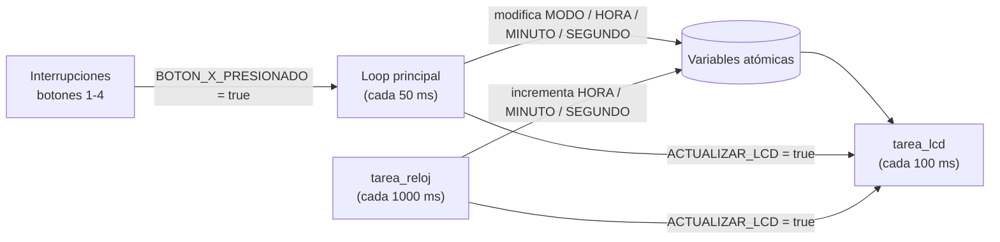

# MPB26-P05 — Reloj digital con LCD y botones (ESP32 + Rust)

Reloj digital que muestra la hora (`HH:MM:SS`) y el modo actual en una pantalla LCD 16x2.
La hora se puede ajustar con 4 botones conectados por interrupción.

---

## 1. ¿Qué código se cambió?

Se separó el **incremento de la hora** del `loop` principal y se movió a una **tarea (hilo) nueva** llamada `tarea_reloj`.

### Antes

El `loop` principal se encargaba de **dos cosas a la vez**: contar el tiempo y atender los botones.
Usaba un contador de ciclos de 50 ms; cuando llegaba a 20 (20 × 50 ms ≈ 1 s), sumaba un segundo.

```rust
let mut contador = 0;

loop {
    FreeRtos::delay_ms(50);

    contador += 1;
    if contador == 20 {
        contador = 0;
        // ... incrementar s, m, h ...
        ACTUALIZAR_LCD.store(true, Ordering::Relaxed);
    }

    if BOTON_1_PRESIONADO.swap(false, Ordering::Relaxed) {
        // ...
        FreeRtos::delay_ms(150);   // <- este retardo también frena al reloj
        // ...
    }
    // ... botones 2, 3 y 4 ...
}
```

### Después

Se creó `tarea_reloj` con la **misma estructura** que `tarea_lcd` (`thread::Builder`, nombre, `stack_size`, `spawn`, `expect`).
Esta tarea espera 1000 ms y suma un segundo, sin hacer nada más.

```rust
// Tarea dedicada únicamente a incrementar la hora cada segundo
thread::Builder::new()
    .name("tarea_reloj".to_string())
    .stack_size(4096)
    .spawn(move || {
        log::info!("Tarea del reloj inicializada correctamente.");
        loop {
            FreeRtos::delay_ms(1000);
            // ... incrementar s, m, h ...
            ACTUALIZAR_LCD.store(true, Ordering::Relaxed);
        }
    })
    .expect("Error al iniciar la tarea del reloj");

loop {
    FreeRtos::delay_ms(50);
    // ... solo atención de botones 1, 2, 3 y 4 ...
}
```

**Resumen del cambio:**

| Elemento | Antes | Después |
|---|---|---|
| Variable `contador` | En `main` | **Eliminada** (ya no hace falta) |
| Incremento de `s`, `m`, `h` | Dentro del `loop` principal | Dentro de `tarea_reloj` |
| Base de tiempo | 20 ciclos × 50 ms | `FreeRtos::delay_ms(1000)` |
| `loop` principal | Reloj + botones | **Solo botones** |

---

## 2. ¿Por qué se cambió?

1. **El reloj se atrasaba al pulsar botones.**
   Cada vez que se atiende un botón se ejecuta `FreeRtos::delay_ms(150)` (antirrebote).
   Como el conteo del tiempo estaba en el mismo `loop`, ese ciclo duraba 200 ms en lugar de 50 ms,
   y el reloj se atrasaba en cada pulsación. Ahora el reloj vive en su propia tarea, así que los
   retardos de los botones ya no lo afectan.

2. **Una tarea, una responsabilidad.**
   Igual que la LCD ya tenía su propia tarea (`tarea_lcd`), ahora el reloj también la tiene.
   El código queda más ordenado y cada parte es más fácil de entender y modificar.

3. **Código más simple.**
   Ya no hace falta el contador de ciclos para obtener 1 segundo; basta con esperar 1000 ms.

---

## 3. Lógica de funcionamiento actual

El programa ahora tiene **3 flujos ejecutándose en paralelo** (sobre FreeRTOS), más las
**interrupciones** de los botones. Se comunican entre sí únicamente mediante **variables atómicas**.



### Variables compartidas

| Variable | Tipo | Uso |
|---|---|---|
| `HORA`, `MINUTO`, `SEGUNDO` | `AtomicU8` | Hora actual |
| `MODO` | `AtomicU8` | `NORMAL`, `AJUSTAR_HOR`, `AJUSTAR_MIN`, `AJUSTAR_SEG` |
| `ACTUALIZAR_LCD` | `AtomicBool` | Avisa a la LCD de que debe redibujar |
| `BOTON_1..4_PRESIONADO` | `AtomicBool` | Banderas levantadas por las interrupciones |

### 3.1 Interrupciones de los botones

Cada botón está configurado con `Pull::Up` e interrupción por flanco de bajada (`NegEdge`).
Al pulsarlo, la interrupción **solo** pone su bandera en `true`; no hace nada más (así la ISR es mínima y rápida).

### 3.2 `tarea_reloj` (cada 1 s)

1. Espera 1000 ms.
2. Lee `HORA`, `MINUTO`, `SEGUNDO`.
3. Suma 1 segundo con acarreo: `s = 60 → s = 0, m + 1`; `m = 60 → m = 0, h + 1`; `h = 24 → h = 0`.
4. Guarda los nuevos valores.
5. Imprime la hora por log y pone `ACTUALIZAR_LCD = true`.

### 3.3 Loop principal (cada 50 ms) — atención de botones

Revisa las banderas con `swap(false)` (lee y limpia en una sola operación):

| Botón | Acción |
|---|---|
| **Botón 1** | Cambia de modo en ciclo: `NORMAL → HOR → MIN → SEG → NORMAL` |
| **Botón 2** | Incrementa el campo del modo actual (hora `% 24`, minuto/segundo `% 60`) |
| **Botón 3** | Decrementa el campo del modo actual (`+23 % 24` / `+59 % 60` para evitar negativos) |
| **Botón 4** | Vuelve directamente al modo `NORMAL` |

Después de cada pulsación: espera 150 ms (antirrebote), **vuelve a habilitar la interrupción**
del botón (`enable_interrupt()`, porque ESP-IDF la deshabilita al dispararse) y pone `ACTUALIZAR_LCD = true`.

### 3.4 `tarea_lcd` (cada 100 ms)

1. Si `ACTUALIZAR_LCD` es `true` (y la pone en `false` con `swap`):
   - Fila 0: `Hora:   HH:MM:SS`
   - Fila 1: `Modo:   NORMAL` / `HOR` / `MIN` / `SEG`
2. Espera 100 ms y repite.

La LCD solo se redibuja cuando algo cambió, no en cada ciclo.

---

## 4. Notas

- En los modos de ajuste el reloj **sigue avanzando** (igual que antes del cambio).
- `delay_ms(1000)` no tiene en cuenta el tiempo de ejecución del propio ciclo, por lo que puede
  existir una deriva muy pequeña a largo plazo. Para una precisión mayor se podría usar un
  temporizador de hardware o `vTaskDelayUntil`.
- El loop principal y `tarea_reloj` pueden escribir la hora casi al mismo tiempo (por ejemplo, al
  pulsar el botón 2 justo cuando pasa un segundo). Como cada uno hace leer → modificar → guardar,
  en ese caso puntual uno de los dos cambios se puede perder. La probabilidad es muy baja y no
  afecta al uso normal.
